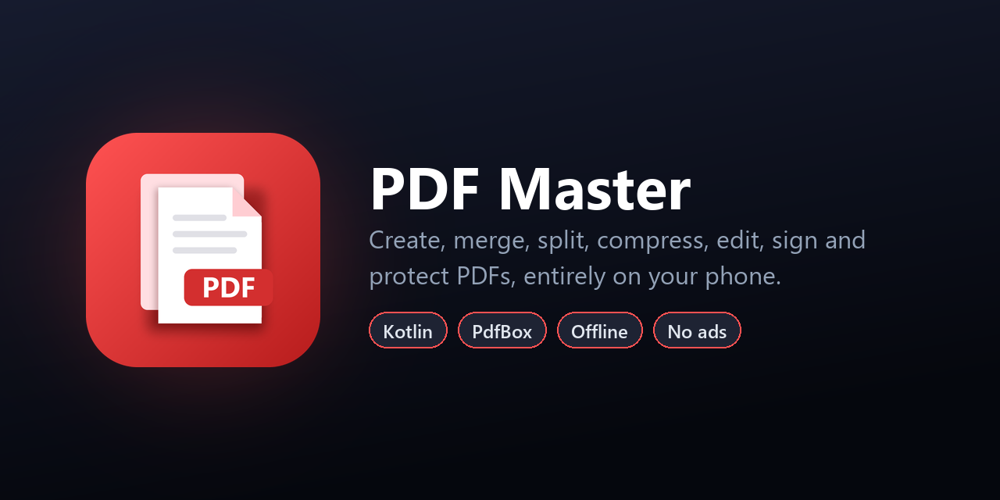

<p align="center">
  
</p>

<p align="center">
  <a href="https://github.com/souvik-das-tech/PDFMaster/releases/latest"></a>
  
  
  
  
  
</p>

# PDF Master

An all-in-one PDF toolkit for Android that does everything **on the phone**. The app has no
internet permission and uses no servers, so your documents never leave the device. It has
no accounts and no ads.

## Download

Get the latest APK from **[Releases](https://github.com/souvik-das-tech/PDFMaster/releases/latest)**
(Android 8.0 or newer).

## Features

### Create
- **Image to PDF** from the gallery, the camera or image files. Drag to reorder, rotate and
  remove pages. Choose the page size (A4, Letter, Legal, A5, or fit to photo), orientation,
  margins, quality and black & white. Your choices are remembered.
- **Camera Scan**: snap pages one after another into a single PDF.
- **Text to PDF**: real, selectable text in any script the phone can display (Bangla, Hindi, …).

### Organize
- **Merge** PDFs (drag to set the order), **Split** (every page, every N pages, or custom
  ranges), **Extract** pages, **Organize** pages (reorder, rotate, delete, reverse).

### Optimize
- **Compress**: *smart* mode shrinks images while keeping text sharp, at three strengths, and
  *maximum* mode turns pages into images. The size saved is shown afterwards.
- **Black & white** conversion.

### Security
- **Add password** with 256-bit AES and choose print / copy / edit permissions.
  **Remove password**.
- Password-protected PDFs open everywhere in the app once you enter the password.

### Edit
- **Edit PDF text**: tap a line of text to change, restyle or delete it, or tap an empty spot to
  add new text. Old text is actually removed from the page content (not just covered up), and
  new text reuses the original font when that font contains the needed characters.
- **Watermark** (diagonal, centre or tiled, with colour, opacity and size) with a live preview.
- **Page numbers** (6 positions, 4 formats, start number, size).
- **Sign PDF**: draw a signature or use a picture or stamp, then drag and resize it on any
  page. Your last signature is remembered.
- **Properties**: view details and edit the title, author, subject and keywords.

### Convert & view
- **PDF to images** (JPG / PNG, three sizes) saved to the gallery.
- **PDF to text**: copy, share, or save as `.txt`.
- **Viewer** with pinch and double-tap zoom, a page counter, go-to-page, share, save, print,
  and quick access to every tool.
- **My PDFs**: search, share, save to phone, rename, delete.
- **Open with** and **Share to** PDF Master from other apps (PDFs and photos).

## Architecture

| File | Responsibility |
| --- | --- |
| `PdfOps.kt` | Every PDF operation (merge, split, compress, encrypt, watermark, …) on PdfBox-Android |
| `PdfText.kt` | Edit PDF: finding text runs, rewriting the page content stream, font handling |
| `Raster.kt` | Previews, thumbnails and page images with Android's `PdfRenderer` |
| `Creators.kt` | Images to PDF and text to PDF |
| `AppModel.kt` | Navigation, background jobs with progress, password prompts |
| `Store.kt` | The app's document library |
| `*Screen.kt` | One file per screen (Home, Viewer, Merge, Pages, Images, Sign, EditText, Form, Results) |
| `tool/generate_icons.py` | Draws the launcher icons and the logos in `branding/` |

## Tests

```bash
./gradlew connectedDebugAndroidTest    # needs a connected device or emulator
```

The instrumented tests run **every PDF operation** end to end on a real device, and cover
text editing: replacing, deleting and adding text, including on PDFs produced by Text to PDF.

## Tech stack

- **Kotlin 2.4**, **Jetpack Compose** (Material 3), Coroutines
- [PdfBox-Android](https://github.com/TomRoush/PdfBox-Android) (Apache 2.0) for PDF editing
- Android `PdfRenderer` for rendering, AndroidX DocumentFile and ExifInterface
- Min SDK 26 (Android 8.0), target SDK 36

## Privacy

There is **no `INTERNET` permission**, so the app cannot send data anywhere. Photos come from
the system photo picker and the camera app, and files are opened through Android's file
picker. No storage permission is needed.

## Build from source

Requirements: Android Studio (or the Android SDK with platform 36) and JDK 17+.

```bash
git clone https://github.com/souvik-das-tech/PDFMaster.git
cd PDFMaster
./gradlew assembleRelease     # app/build/outputs/apk/release/app-release.apk (R8-minified)
```

The release build is signed with the debug key so it installs out of the box. Add your own
`signingConfig` before publishing to a store.

## License

Released under the [MIT License](LICENSE). PdfBox-Android is licensed under Apache 2.0.

## Author

**Souvik Das** · [GitHub @souvik-das-tech](https://github.com/souvik-das-tech)

If you find this project useful, please consider giving it a ⭐.
